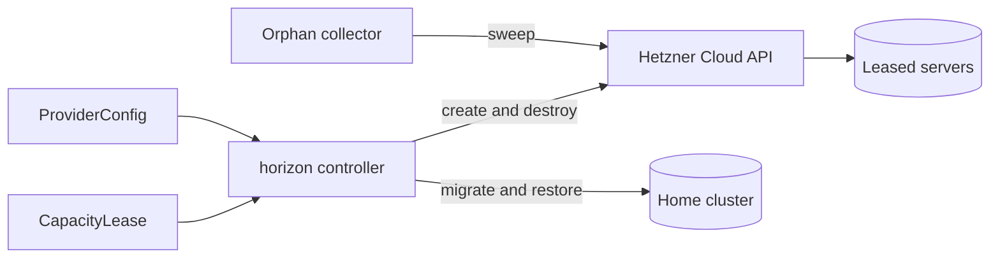

# horizon

[](https://github.com/lucawalz/horizon/actions/workflows/ci.yaml)
[](https://github.com/lucawalz/horizon/releases)
[](LICENSE)


A Kubernetes operator that leases temporary Hetzner Cloud capacity and guarantees the machines are gone when the lease expires.



## Installation

horizon installs as a Helm chart into an existing cluster. Nothing else is deployed, and the cluster keeps running unchanged until a lease is created.

The requirements, installing from a checkout and building from source are in [docs/design.md](docs/design.md#requirements).

### Installing the controller

The controller is installed from the Helm chart, published as an OCI artifact by a release tag:

```
helm install horizon oci://ghcr.io/lucawalz/charts/horizon \
  --namespace horizon-system --create-namespace
```

[`charts/horizon/README.md`](charts/horizon/README.md) carries every value, what else the chart templates, and why the definitions live in `crds/` rather than `templates/`.

## Usage

horizon carries six commands in one binary, and `horizon` with no subcommand prints help. Every flag, with its default and what it is for, is in [docs/cli-reference.md](docs/cli-reference.md).

### The smallest example

With the chart installed and a `ProviderConfig` applied, a lease is the whole interface. This one asks for a single `cpx22` in `nbg1` for thirty minutes:

```yaml
apiVersion: horizon.dev/v1alpha1
kind: CapacityLease
metadata:
  name: batch-run
spec:
  providerRef: hetzner
  region: nbg1
  size: cpx22
  replicas: 1
  duration: 30m
```

```
kubectl apply -f capacitylease.yaml
kubectl get capacityleases
```

That prints the lease once its node has registered and its watchdog has armed:

```
NAME        REPLICAS   REGION   PHASE    EXPIRES                READY   ARMED   AGE   TYPE
batch-run   1          nbg1     Active   2026-08-24T14:30:00Z   True    True    92s   cpx22
```

Getting an empty cluster to that point is eight steps: the chart, three Secrets, a rendered cloud-init, a fourth Secret holding it, a `ProviderConfig`, and the lease. [docs/usage.md](docs/usage.md) walks all eight with the commands and the rendered output, and covers images and clusters that are not stock.

## Why not Karpenter or cluster-autoscaler

Karpenter and cluster-autoscaler size a cluster to its pending pods; horizon instead treats the deadline as the contract. A `CapacityLease` states how long capacity exists, and a finalizer, labels written in the create call, an orphan collector and a node-side watchdog make deletion the guaranteed outcome ([ADR 0017](docs/adr/0017-capacity-lease-controller-over-cli-saga.md)). The provider seam is drawn around one named instance rather than a count, so ownership and expiry attach to individual machines ([ADR 0018](docs/adr/0018-provider-seam-around-instance-lifecycle.md)). Like those projects, horizon builds no machine images and renders the join cloud-init for stock ones instead ([ADR 0022](docs/adr/0022-generate-cloud-init-rather-than-build-images.md)). The full design is in [docs/design.md](docs/design.md).

## Documentation

| Document | What it covers |
| --- | --- |
| [docs/usage.md](docs/usage.md) | The eight-step path from an empty cluster to a registered node, how teardown is enforced, images and clusters that are not stock, and what the web interface serves, including `ProviderConfig` status. |
| [docs/cli-reference.md](docs/cli-reference.md) | Every command and every flag, with its default. |
| [docs/serving-the-interface.md](docs/serving-the-interface.md) | Serving the interface in a cluster, granting an impersonated operator its rights, and reading a refusal. |
| [charts/horizon/README.md](charts/horizon/README.md) | Every chart value, and why the custom resource definitions live in `crds/` rather than `templates/`. |
| [docs/adr/](docs/adr/) | Thirty-seven architecture decision records in MADR format, superseded ones included. |
| [CONTRIBUTING.md](CONTRIBUTING.md) | Repository layout, the test commands, the web interface bundle, and the branch and commit conventions. |
| [SECURITY.md](SECURITY.md) | The credential model, how to report a vulnerability, and the supported release line. |
| [docs/design.md](docs/design.md) | The project description, teardown enforcement, the capacity model, lease semantics, the web interface, and project housekeeping. |

## License

Released under the MIT License, Copyright (c) 2026 Luca Walz. The full text is in [LICENSE](LICENSE).

## Project status

Actively developed alongside the [bedrock](https://github.com/lucawalz/bedrock) homelab it was written for, and published one version per release tag at `ghcr.io/lucawalz/charts/horizon` and `ghcr.io/lucawalz/horizon`.
